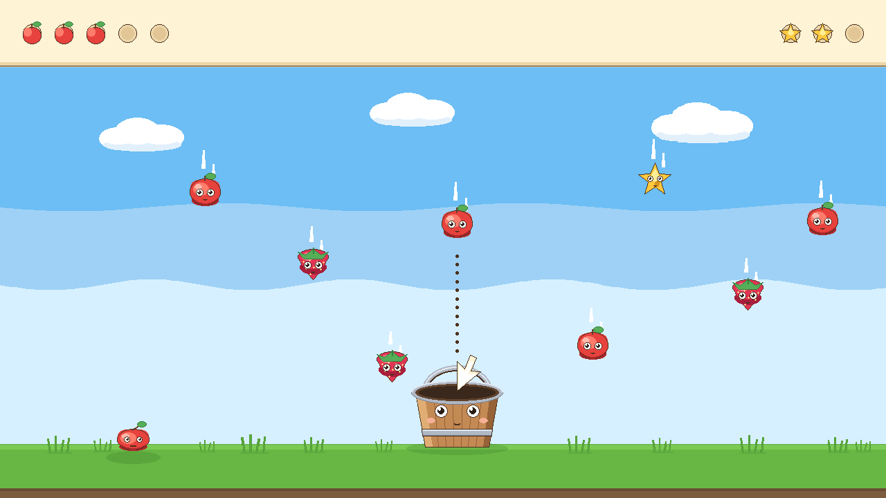
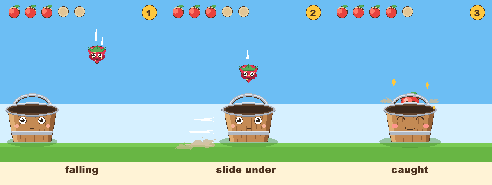

# Bucket Catch — mockup

Art and layout for **tier 1**, drawn *after* the build rather than before it. This game already
ships, so the mockup is not a proposal for what the game could be — it is a re-drawing of what the
game does, at a size and in a style the build cannot currently afford. `tools/make-art.py` and
`tools/make-mockup.py` are drawing scripts, not a game.

Nothing under `assets/art/` is touched. The shipped sprites are load-bearing: `CatchScreen` loads
them by filename, and a clobbered PNG breaks a working build. The mockup art is authored fresh into
`assets/art/mockup/`, and the original generator is preserved unchanged as
`tools/make-art-shipped.py`.





## Regenerate

```
python tools/make-art.py      # sprites -> assets/art/mockup/ + tools/preview.png
python tools/make-mockup.py   # -> mockup.png (1280x720) and mockup-catch.png (1200x452)
```

## What the mockup is for

Tier 1 is the first verb in the ladder, and it is a **tracking** verb, not a timing one. There is no
moment to get right; there is a place to be, continuously, and the whole skill is keeping the bucket
where the falling thing is about to land. A line of text can say that. Only a picture can show
whether a four-year-old would *see* it.

The ladder's one line for this tier is: *move cursor; fruit falls; bucket follows X; catch N fruit.*

## What the screen settles

**The pointer points into the bucket, not at the sky.** The cursor sprite is authored pointing
up-left, the way a real mouse arrow does — and pasted flipped, so its point aims down and sits in
the bucket's mouth, on the bucket's own x. A pointer aimed away from the thing it moves reads as two
objects that happen to overlap. Aimed into the mouth, it reads as one object: the bucket is wearing
the pointer.

**The guide is one number, matched.** A dotted line runs from the falling fruit straight down through
the pointer into the pail. Fruit, pointer and bucket all share a single x, and the dots are the proof
of it — they are spread evenly end to end rather than stepped down from the top, because a stepped
line leaves a ragged half-step of nothing at the bottom and the guide then looks like it stops short
of the bucket it is pointing at.

**Several fruit, several heights.** One fruit in the air is a screenshot of an event. Seven, at
different heights and with motion streaks of different lengths, is a *condition* — things fall here,
this is what you are watching. The star rides the same fall, higher up, so the bonus is visibly the
same kind of object.

**A miss is not a strike.** Nothing in the picture punishes the fruit on the grass. It is squashed
flat by its own weight, its eyes are level, its mouth is a small smile, and it has a contact shadow
tying it to the lawn. No X eyes, no red, no counter going backwards, no puff of impact — an earlier
pass put two dust puffs beside it and they read as small clouds sitting on the grass. The build
agrees: a missed fruit costs nothing, and the run only ends if a spiky rock lands *in* the bucket.

**The bucket's face does the reacting.** Eyes up and open while it is being steered, a plain smile at
rest. Colour is identity and posture is state — the same pail, three expressions, never a second
character.

**HUD is pictures only.** Five fruit sockets on the left, three stars on the right, both drawn as
real empty sockets rather than faded sprites: a 22%-alpha apple read as *a pale apple*, i.e. a
different fruit, and the count stopped being countable. Empty sockets are a deeper tan than the HUD
band so filled and unfilled are separable at a glance. The mockup shows three of five and two of
three — one fruit caught, one star caught, matching what is on the screen.

## Departures from the build, and why

**The sky is stepped, not smooth.** The build stretches a 32x256 gradient over the window. Flat-fill
house style forbids dithering a gradient, so the mockup paints three tones with wavy seams. They are
close enough in value to read as one sky and not as a horizon band or a strip of water.

**The HUD band is 96px, not 118.** `CatchScreen` reserves 118 for a band of text. A picture HUD needs
96, and the 22px goes back to the sky the player is actually watching. This is the one deliberate
geometry departure; everything else — `GROUND_Y` at 78 (y=642), the bucket's base at 68 (y=652), the
catch line at 74% of the bucket's height (y=557) — is the build's own number, and is named after it
in `make-mockup.py`.

**The rock is not in the picture.** See below.

## What it leaves open

- **The rock.** The build's menu says *"Catch the fruit — let the spiky rocks fall!"* and a rock in
  the bucket ends the run. Tier 1's line has no hazard in it at all. Either the rock belongs to a
  later tier and shipped too early, or the ladder line is under-selling tier 1. The mockup draws the
  no-hazard version, because that is what the line describes.
- **What N is.** Five fruit in the HUD; whether a round is five, ten or endless is not decided, and
  the difficulty ramp in the build is time-based rather than count-based.
- **Whether the pointer is drawn at all.** In the build the bucket follows the OS cursor, which is
  invisible in a screenshot. The mockup has to draw one to make the relationship visible; a shipped
  game may want its own arrow so the pointer matches the art.
- **The bucket's lean.** The build tilts the bucket up to 4° toward its direction of travel. A still
  image shows it upright, which loses that cue. Whether the lean is worth drawing in a still, or is
  only legible in motion, is untested.
- **The catch radius.** The mockup draws the fruit landing dead centre. How forgiving the mouth is —
  and whether a near-catch needs its own cue — is a code decision, not an art one.
- **The fruit mix.** Apple, strawberry and star are all authored; the mockup shows apples plus one
  star. Whether strawberries are worth more than apples (the build says 15 vs 10) is invisible
  without a number on screen, and tier 1 has no numbers.

## Files

```
assets/art/mockup/   14 sprites, authored 1:1 at the size CatchScreen draws them
                     bucket 144x128, fruit 54x54, cursor 44x58, pips 36x36
tools/make-art.py          sprites + contact sheet
tools/make-mockup.py       the two composites
tools/make-art-shipped.py  the game's own generator, untouched
mockup.png                 1280x720, the screen
mockup-catch.png           1200x452, three panels: falling, slide under, caught
```
