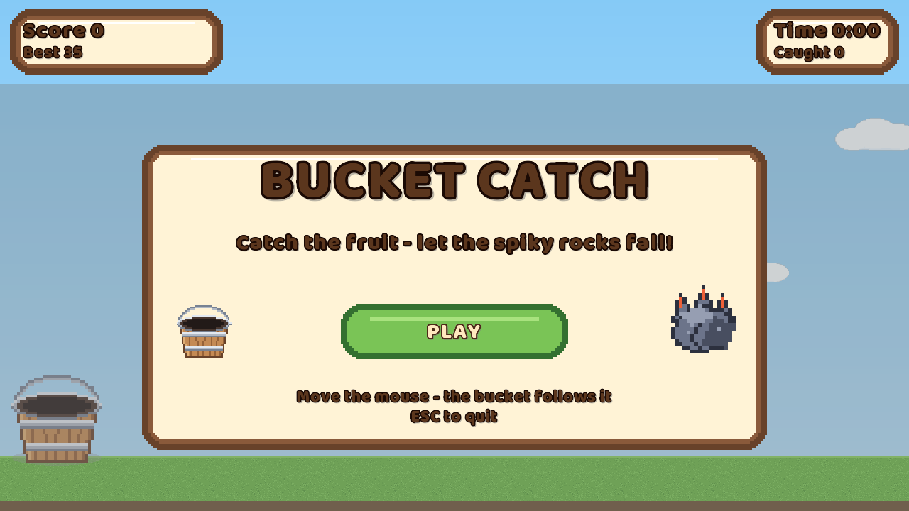
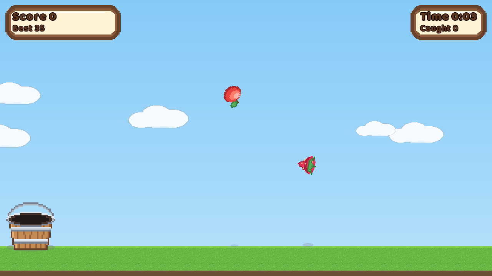

# Bucket Catch

A libGDX (LWJGL3) desktop game. Slide a bucket along the lawn and catch the falling fruit - and let
the spiky rocks fall past it, because a rock landing in the bucket ends the run.





## Play

```
./gradlew lwjgl3:run
```

Or run the standalone jar (no Gradle needed):

```
java -jar lwjgl3/build/libs/catch-1.0.0-all.jar
```

Build that jar with `./gradlew lwjgl3:fatJar`; it is also produced by a normal `./gradlew build`.

## Controls

- **Move the mouse** - the bucket follows the cursor horizontally. Nothing is ever clicked during
  play.
- **ESC** - quit.
- **Click PLAY / TRY AGAIN** - start a run, or start another one after a loss.

## Rules

- Catching fruit scores: apple 10, strawberry 15, star 25.
- Missing a fruit costs nothing.
- A rock landing in the bucket's mouth ends the run. Rocks that miss are harmless, which is what
  makes sliding out of the way the whole game.
- Falling speed and rock frequency ramp up over the first 80 seconds.
- The best score is saved to libGDX preferences and shown in the HUD.

The bucket's mouth is the only catching surface: an object is caught on the frame its underside
crosses the rim while it is horizontally inside the mouth, so sliding under something after it has
already passed the rim cannot catch it retroactively.

## Layout

The score band sits **above** the playfield rather than floating over it, so a HUD panel can never
hide the objects the player is judging.

## Assets

`assets/art` is generated by `tools/make-art.py` (sky, cloud, grass, bucket, fruit, rock, panel and
button sprites) and committed as PNGs so it is reviewable and regenerable rather than an opaque
blob. Pixel art is authored at its logical size and upscaled with `TextureFilter.Nearest`.

The UI font is **Baloo 2 ExtraBold** (`assets/fonts/Baloo2-ExtraBold.ttf`). `Sniglet-ExtraBold.ttf`
is kept as an A/B fallback; the face is a named constant, so it can be swapped without a rebuild:

```
java -Dcatch.font=Sniglet-ExtraBold.ttf -jar lwjgl3/build/libs/catch-1.0.0-all.jar
```

`logTextFits()` measures every UI string against the panel it is drawn in at startup and logs an
error for anything too wide, so a font swap cannot silently overflow a panel.

## Screenshots

The PNGs above were captured **from inside the game's framebuffer** (`Screenshot.java`), not with an
external screen grab - on Windows a GPU-composited OpenGL window comes back blank white to
`PrintWindow` and friends even while the game is drawing perfectly.

```
java -jar lwjgl3/build/libs/catch-1.0.0-all.jar --shot=/tmp/menu.png
java -jar lwjgl3/build/libs/catch-1.0.0-all.jar --seed=7 --autostart \
     --shot-frames=200 --shot=/tmp/play.png
```

Optional flags: `--seed=N` pins the run, `--autostart` skips the menu,
`--shot=<path>` writes one PNG then quits, `--shot-frames=N` how many frames to draw first.

## Layout of the project

```
core/     platform-independent game code (CatchGame.java, CatchScreen.java, Screenshot.java)
lwjgl3/   desktop launcher + build config
assets/   art/ (PNGs from tools/make-art.py) and fonts/; on the classpath and the run task's
          working directory
tools/    make-art.py - regenerates every sprite, plus a contact sheet
```
